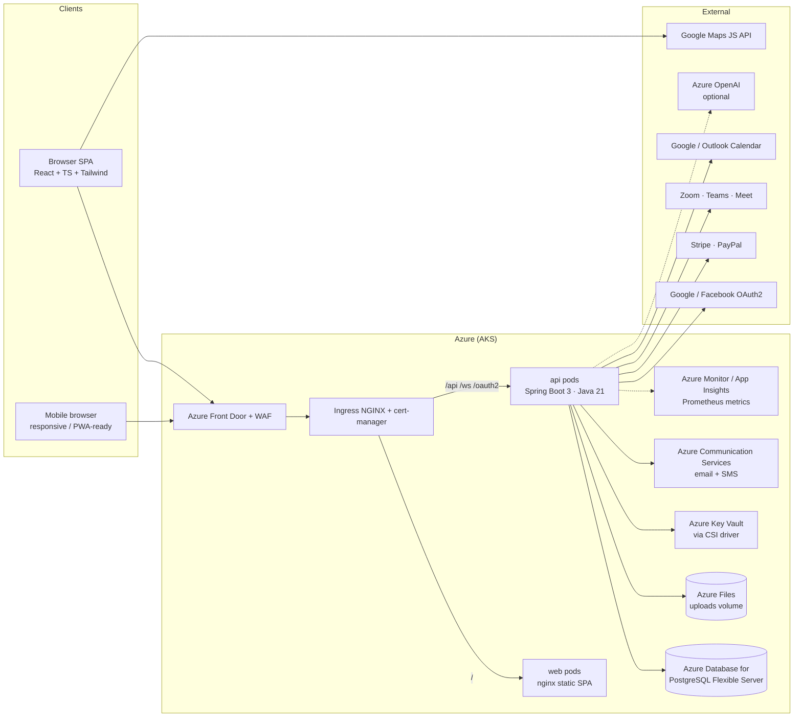
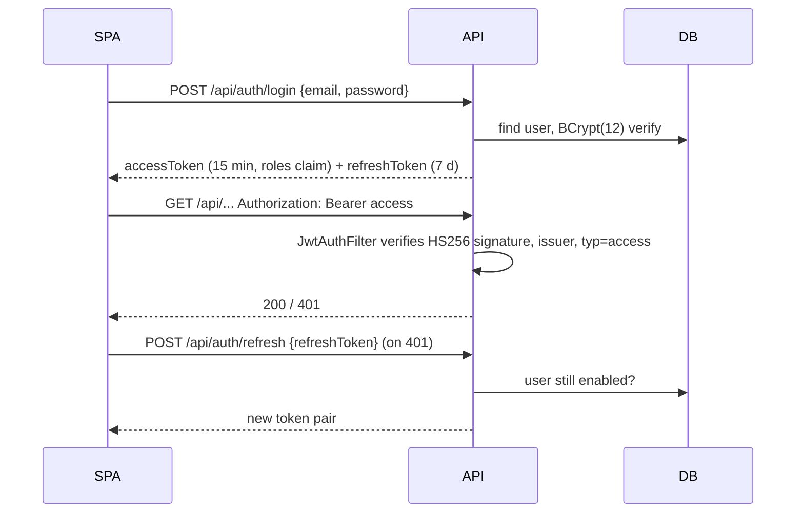

# System Architecture

## 1. High-level view



## 2. Backend (modular monolith)

The API is a single deployable split into clear layers. It can be carved into services later along the
package boundaries (identity, catalog/search, booking, payments, messaging) without changing the REST contract.

| Layer | Package | Responsibility |
|---|---|---|
| Web | `web` | REST controllers, request validation (`@Valid`), role routing |
| Service | `service` | Business rules, transactions, orchestration |
| Domain | `domain` | JPA entities + lifecycle enums |
| Persistence | `repository` | Spring Data repositories, native report queries |
| Security | `security`, `config/SecurityConfig` | JWT, OAuth2 login, RBAC, CORS |
| Realtime | `config/WebSocketConfig`, `ChatService`, `NotificationService` | STOMP over WebSocket |
| Integration seams | `PaymentGateway`, `MeetingService`, `NotificationService.ExternalChannels`, `AiService` | Swap-in provider adapters |

Key design decisions:

* **Flyway owns the schema** (`ddl-auto: none`). Migrations live in `backend/src/main/resources/db/migration`.
* **Double-booking is impossible at the database level** via a GiST exclusion constraint on
  `(instructor_id, tstzrange(start_at, end_at))` for `PENDING`/`CONFIRMED` bookings; the service layer checks first for a friendly error.
* **Availability** is stored as rules (recurring weekly, one-off, blocked ranges) in the instructor's IANA time zone and expanded on demand into bookable UTC slots.
* **Pricing** is computed server-side only (`PricingService`): hourly × duration, flat package, or per-student group pricing; deposit % and platform fee % are configuration.
* **Search** filters in SQL (JPA Specifications) with a bounding-box geo pre-filter, then Haversine refinement. Upgrade path: PostGIS `ST_DWithin` + Azure AI Search.

## 3. Frontend

* Vite + React 18 + TypeScript, React Router 6, TanStack Query for server state, Tailwind CSS (class-based dark mode).
* Route-level code splitting (`lazy()`), so map and chart bundles load only where used.
* `api/client.ts` handles bearer tokens and transparent refresh; `hooks/useRealtime.ts` keeps one STOMP connection per session.

## 4. JWT security implementation



| Concern | Implementation |
|---|---|
| Signing | HS256, ≥256-bit key from Key Vault (`JWT_SECRET`); startup fails if key is too short |
| Token types | `typ` claim distinguishes `access` vs `refresh`; refresh tokens cannot call APIs |
| RBAC | Roles `CUSTOMER`, `INSTRUCTOR`, `ADMIN` → `ROLE_*` authorities. URL rules in `SecurityConfig` (`/api/admin/**`, `/api/instructor/**`) plus ownership checks in services |
| Object-level auth | Every booking/review/service mutation verifies the caller owns the resource; foreign bookings return 404 to prevent ID probing |
| Social login | Spring OAuth2 client (Google, Facebook) → `OAuth2SuccessHandler` upserts the user and redirects with tokens in the URL **fragment** (never sent to servers/logs); SPA strips it from history |
| Token storage (SPA) | Access token in memory only; refresh token in `localStorage` |
| WebSocket | STOMP `CONNECT` must carry a valid bearer token (`WebSocketConfig` interceptor) |
| Passwords | BCrypt cost 12; generic "invalid email or password" to avoid account enumeration |
| Uploads | MIME allow-list, random file names, path-traversal guard; identity docs never publicly served |
| Transport/headers | TLS at ingress, HSTS via Front Door, `X-Frame-Options: DENY`, `nosniff`, strict CORS allow-list |

Production hardening backlog: refresh-token rotation with a server-side deny list (Redis), login rate limiting / CAPTCHA, cookie-based OAuth2 authorization request repository (removes ingress session affinity).

## 5. Complete project folder structure

```
SkillConnect/
├── README.md
├── docker-compose.yml              # postgres + mailpit + api + web
├── .env.example
├── .github/workflows/ci-cd.yml     # build, test, push to ACR, deploy to AKS
├── backend/
│   ├── Dockerfile
│   ├── pom.xml
│   └── src/
│       ├── main/java/com/skillconnect/
│       │   ├── SkillConnectApplication.java
│       │   ├── config/        AppProperties, SecurityConfig, WebSocketConfig, JpaConfig, AdminBootstrap
│       │   ├── security/      JwtService, JwtAuthFilter, AuthUser, OAuth2SuccessHandler
│       │   ├── domain/        User, Role, Instructor, InstructorProfile, Category, Subject, AgeGroup,
│       │   │                  ServiceOffering, Location, InstructorLocation, AvailabilitySlot, Booking,
│       │   │                  Payment, Review, Message, Notification, Favorite, Document, Dispute
│       │   ├── repository/    Repositories (all Spring Data interfaces + ReportRow projection)
│       │   ├── dto/           Dtos (request/response records), Mapper
│       │   ├── service/       AuthService, CatalogService, InstructorService, SearchService,
│       │   │                  AvailabilityService, PricingService, BookingService, PaymentService,
│       │   │                  PaymentGateway, ReviewService, ChatService, NotificationService,
│       │   │                  MeetingService, AccountService, AdminService, AiService,
│       │   │                  StorageService, BookingReminderJob
│       │   ├── web/           AuthController, PublicController, UserController,
│       │   │                  InstructorController, AdminController
│       │   └── exception/     ApiException, GlobalExceptionHandler (RFC 7807 problem+json)
│       ├── main/resources/
│       │   ├── application.yml
│       │   └── db/migration/  V1__init_schema.sql, V2__seed_reference_data.sql
│       └── test/java/...      PricingServiceTest
├── frontend/
│   ├── Dockerfile, nginx.conf.template, vite.config.ts, tailwind.config.js, index.html
│   └── src/
│       ├── main.tsx, App.tsx, index.css
│       ├── api/          client.ts (axios + refresh), endpoints.ts, types.ts
│       ├── context/      AuthContext, ThemeContext
│       ├── hooks/        useRealtime (STOMP)
│       ├── lib/          format.ts
│       ├── components/   Layout, ProtectedRoute, ui (design system), InstructorCard, SearchFilters,
│       │                 MapView, BookingCard, AssistantWidget
│       └── pages/
│           ├── Landing, Search, MapSearch, InstructorProfile, BookingWizard,
│           ├── CustomerDashboard, AdminDashboard, Messages, Notifications,
│           ├── Settings, Payments, Calendar
│           ├── auth/        Login, Register, OAuthCallback, shared
│           └── instructor/  InstructorDashboard, Overview, Bookings, Services,
│                            Availability, Locations, Reviews, ProfileSettings
├── deploy/k8s/        kustomization, namespace, config (+Key Vault CSI), storage, api, web, ingress
└── docs/              architecture, database, api, booking-workflow, ui-wireframes, deployment, roadmap
```
