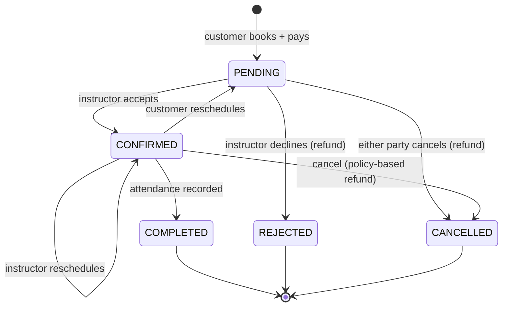
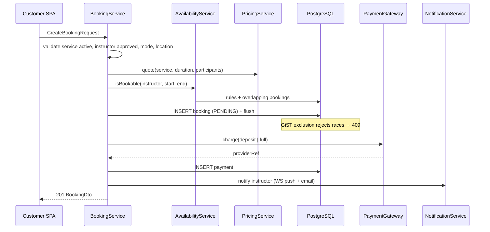

# Booking Workflow

## End-to-end flow

```mermaid
flowchart TD
    A[Customer searches<br/>list or map] --> B[Select instructor]
    B --> C[View profile, services, reviews]
    C --> D{Signed in?}
    D -- no --> L[Login / register / social] --> E
    D -- yes --> E[Booking wizard]
    E --> E1[1. Service · duration · participants · online/in-person]
    E1 --> E2[2. Pick date & time<br/>GET /instructors/:id/availability]
    E2 --> E3[3. Location (in-person) + notes]
    E3 --> E4[4. Live quote POST /bookings/quote<br/>choose payment & deposit]
    E4 --> F[POST /bookings]
    F --> G{Slot still free?<br/>availability rules + exclusion constraint}
    G -- no --> E2
    G -- yes --> H[Charge deposit or full amount]
    H -- failed --> E4
    H -- ok --> I[Booking PENDING<br/>notify instructor]
    I --> J{Instructor decision}
    J -- accept --> K[CONFIRMED<br/>meeting link if online<br/>notify customer · email · SMS]
    J -- reject --> R[REJECTED<br/>full refund]
    K --> M[Reminder 24h before]
    K --> X{Changes?}
    X -- customer reschedules --> I
    X -- instructor reschedules --> K
    X -- cancel ≥24h or by instructor --> C1[CANCELLED · full refund]
    X -- customer cancels <24h --> C2[CANCELLED · deposit retained]
    M --> N[Session happens]
    N --> O[Instructor marks attendance]
    O --> P[COMPLETED<br/>charge balance · record payout]
    P --> Q[Customer reviews · instructor responds]
```

## Booking state machine



## Server-side sequence for `POST /api/bookings`



## Pricing rules

| Type | Formula |
|---|---|
| Hourly | `price × minutes / 60` |
| Package | `price` (flat, covers `packageSessions` sessions) |
| Group | `(groupPricePerStudent ?? price) × minutes / 60 × participants` (≤ `maxStudents`) |
| Deposit | `total × app.payments.default-deposit-percent` (default 20 %) |
| Platform fee | `total × app.payments.platform-fee-percent` (default 15 %) deducted from instructor payout |
