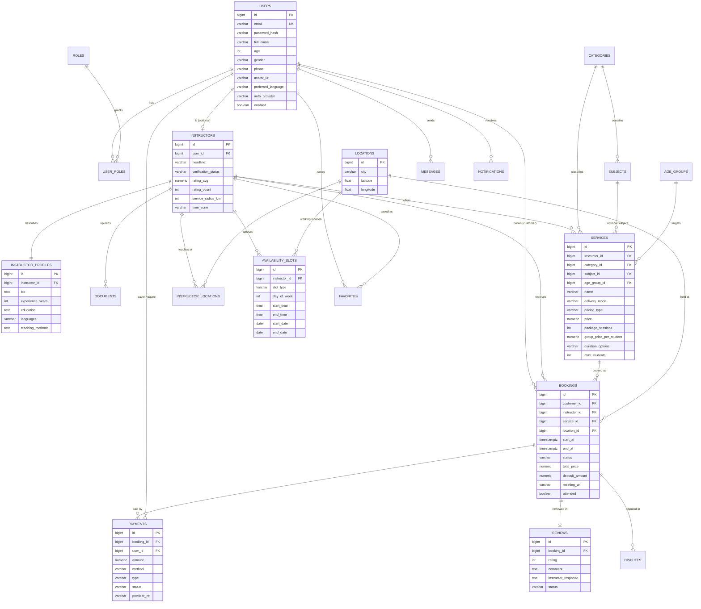

# Database

PostgreSQL 16. The authoritative DDL is in
[V1__init_schema.sql](../backend/src/main/resources/db/migration/V1__init_schema.sql) and reference data in
[V2__seed_reference_data.sql](../backend/src/main/resources/db/migration/V2__seed_reference_data.sql).

## ERD

## Entity notes

| Entity (table) | Purpose |
|---|---|
| Users / Roles (`users`, `roles`, `user_roles`) | Accounts; many-to-many roles. An instructor also has the CUSTOMER role so they can book others. |
| Instructors / InstructorProfiles | Verification status, rating aggregates, radius & time zone / rich profile text. |
| Documents | Certifications and identity documents (private storage). |
| Categories, Subjects, AgeGroups | Admin-managed catalog. 12 categories and 5 age groups seeded. |
| Services (`services`) | Instructor offerings: category, age group, mode, pricing model, durations, capacity. |
| Locations / InstructorLocations | Geocoded addresses; instructors can have several, one primary. |
| AvailabilitySlots | `RECURRING` weekly windows, `ONE_OFF` extra windows, `BLOCKED` vacations/periods. |
| Bookings | Lifecycle `PENDING → CONFIRMED → COMPLETED` (or `REJECTED`/`CANCELLED`); exclusion constraint prevents overlaps. |
| Payments | Ledger rows: `DEPOSIT`, `FULL`, `BALANCE`, `REFUND`, `PAYOUT`. |
| Reviews | One per completed booking, moderation status, instructor response. |
| Messages / Notifications / Favorites | Chat, in-app notification inbox, saved instructors. |
| Disputes | Customer/instructor complaints handled by admins. |

## Indexing & integrity highlights

* `bookings` — `EXCLUDE USING gist (instructor_id WITH =, tstzrange(start_at,end_at) WITH &&) WHERE status IN ('PENDING','CONFIRMED')`.
* `idx_services_search` partial index on active services for the most common filter combination.
* `idx_locations_geo` for bounding-box search; `lower(city)` functional index.
* `idx_messages_pair` on `(LEAST(sender,recipient), GREATEST(sender,recipient), created_at)` for thread reads.
* `CHECK` constraints on ratings (1–5), prices (≥ 0), ages, `end_at > start_at`.
