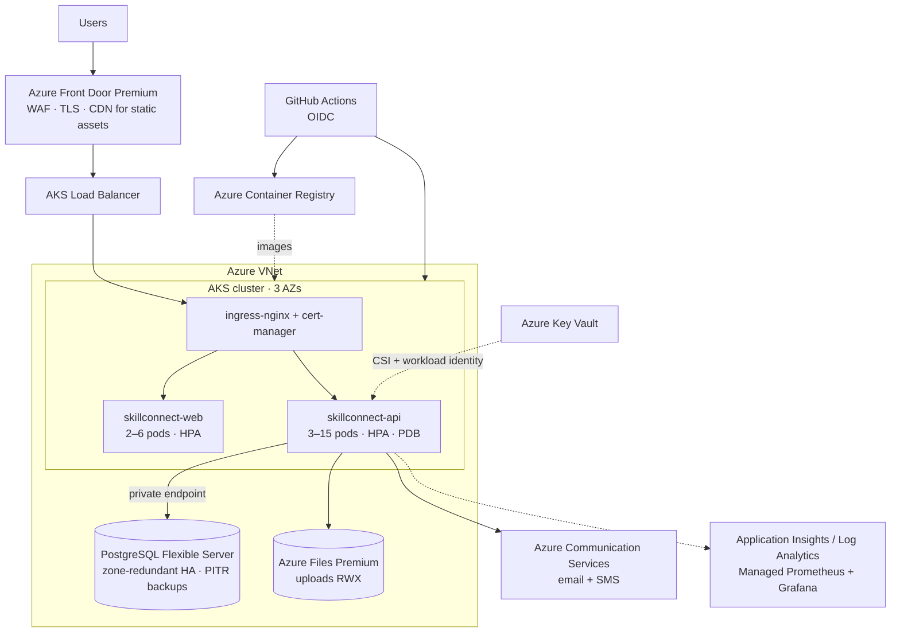

# Deployment — Docker, Kubernetes, Azure

## 1. Target architecture



| Component | Azure service | Notes |
|---|---|---|
| Container images | Azure Container Registry | AKS pulls via managed identity (`--attach-acr`) |
| Orchestration | AKS (system + user node pools, 3 zones) | Pod Security `restricted`, workload identity, CSI secrets |
| Database | Azure Database for PostgreSQL Flexible Server 16 | Zone-redundant HA, private endpoint, `btree_gist` extension allow-listed |
| Files | Azure Files Premium (CSI, RWX) | Avatars & documents; migrate to Blob + SAS later |
| Secrets | Azure Key Vault | JWT key, DB creds, OAuth secrets, SMTP creds |
| Edge | Azure Front Door + WAF | OWASP rule set, bot protection, rate limiting |
| Email / SMS | Azure Communication Services | SMTP relay for email; SMS adapter in `ExternalChannels.sms` |
| Observability | App Insights Java agent, Managed Prometheus (`/actuator/prometheus`), Grafana | |

## 2. Local (Docker Compose)

```bash
cp .env.example .env            # set JWT_SECRET (openssl rand -base64 48) and ADMIN_PASSWORD
docker compose up --build
# Web http://localhost:3000 · API docs http://localhost:8080/swagger-ui.html · Mail http://localhost:8025
```

## 3. Provision Azure (one-time)

```bash
RG=skillconnect-rg; LOC=westeurope
az group create -n $RG -l $LOC
az acr create -g $RG -n skillconnectacr --sku Standard
az aks create -g $RG -n skillconnect-aks --zones 1 2 3 --node-count 3 \
  --enable-oidc-issuer --enable-workload-identity --enable-addons azure-keyvault-secrets-provider \
  --attach-acr skillconnectacr --network-plugin azure --generate-ssh-keys
az postgres flexible-server create -g $RG -n skillconnect-pg --version 16 --tier GeneralPurpose \
  --sku-name Standard_D2ds_v5 --high-availability ZoneRedundant --storage-size 128
az postgres flexible-server parameter set -g $RG -s skillconnect-pg -n azure.extensions --value BTREE_GIST
az postgres flexible-server db create -g $RG -s skillconnect-pg -d skillconnect
az keyvault create -g $RG -n skillconnect-kv --enable-rbac-authorization
# add secrets: db-user, db-password, jwt-secret, google-*, facebook-*, smtp-*
az identity create -g $RG -n skillconnect-api-id
# federate the identity with the AKS service account skillconnect/skillconnect-api,
# grant it "Key Vault Secrets User", then put its client ID into deploy/k8s/config.yaml and api.yaml.
```

Cluster add-ons: `ingress-nginx`, `cert-manager` with a `letsencrypt` ClusterIssuer.

## 4. Deploy

CI/CD (`.github/workflows/ci-cd.yml`) runs tests, builds both images tagged with the commit SHA, pushes to ACR
and applies `deploy/k8s` with Kustomize, then waits for rollout. Manual equivalent:

```bash
kubectl apply -k deploy/k8s
kubectl -n skillconnect rollout status deploy/skillconnect-api
```

Flyway migrations run automatically on API start-up (single-writer lock in the DB, so concurrent pods are safe).

## 5. Scaling & multi-replica considerations

| Concern | MVP | Scale-out |
|---|---|---|
| WebSocket fan-out | In-memory STOMP broker | Switch to broker relay (RabbitMQ STOMP) or Azure Web PubSub so users connected to any pod receive messages |
| Scheduled reminders | `@Scheduled` per pod | Add ShedLock (JDBC) so only one pod runs the job |
| OAuth2 login state | HTTP session + ingress cookie affinity | Cookie-based `AuthorizationRequestRepository` → fully stateless |
| Search | SQL + bounding box | PostGIS + Azure AI Search |
| Files | Azure Files | Blob Storage + CDN, SAS URLs for private docs |
| Caching | none | Azure Cache for Redis for catalog, quotes, token deny-list |

## 6. Operations

* **Health**: `/actuator/health/liveness|readiness` wired to K8s probes.
* **Backups**: PostgreSQL PITR (35 days) + geo-redundant backups; Azure Files snapshots.
* **DR**: secondary region with read replica + Front Door failover.
* **Security**: Defender for Containers, ACR image scanning, network policies (api ↔ db only), no public DB endpoint.
